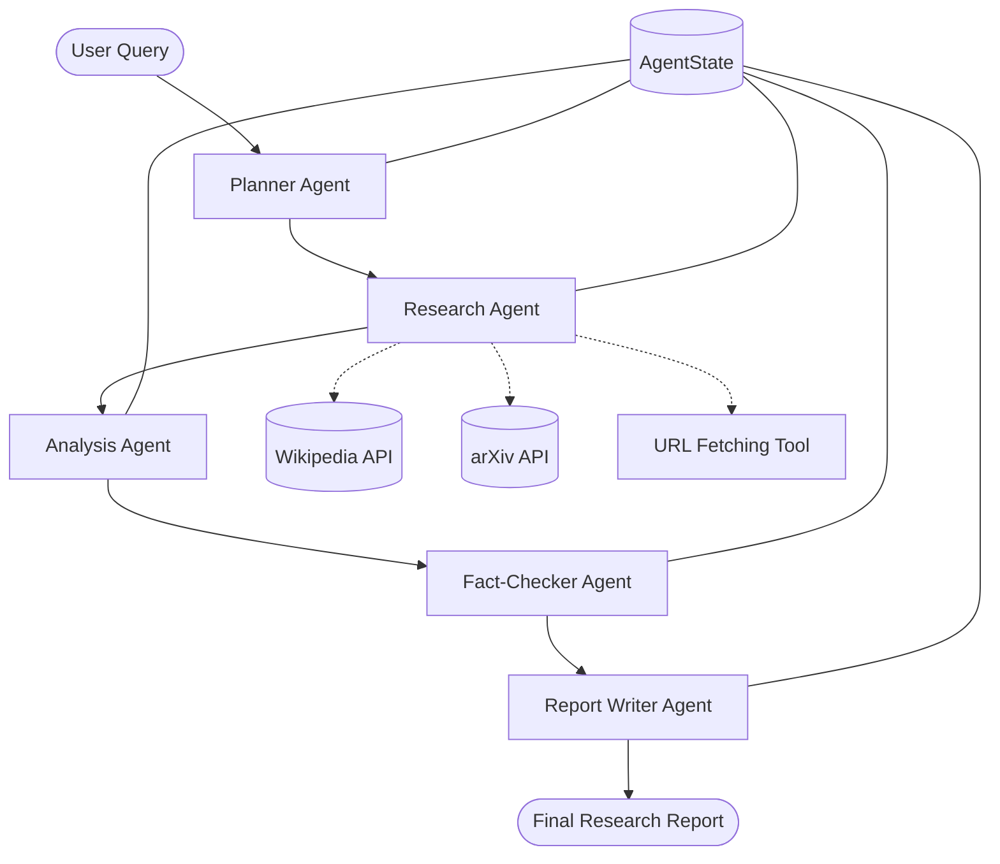

# Multi-Agent Research Assistant

An AI-powered research assistant built with Python, LangGraph, and the OpenAI API.

The system uses five specialised agents to plan research, collect information, analyse findings, verify claims, and generate structured reports.

## Overview

Given a research question, the application executes a predefined multi-agent workflow and produces a final research report.

## Architecture

The system consists of five specialised agents:

| Agent | Responsibility |
|---|---|
| Planner Agent | Creates a structured research plan |
| Research Agent | Collects information from Wikipedia and arXiv |
| Analysis Agent | Analyses collected research materials |
| Fact-Checker Agent | Checks claims against available research materials |
| Report Writer Agent | Generates the final research report |

### Workflow

```text
User Query
    |
    v
Planner Agent
    |
    v
Research Agent
    |
    v
Analysis Agent
    |
    v
Fact-Checker Agent
    |
    v
Report Writer Agent
    |
    v
Final Research Report
```

The workflow is orchestrated using LangGraph.
### Architecture Diagram



The workflow uses a shared `AgentState` to pass information between agents. Research tools are used by the Research Agent to retrieve external information.

## Key Features

- Multi-agent architecture
- Sequential workflow orchestration
- Information retrieval from Wikipedia and arXiv
- Web page content extraction
- LLM-powered research analysis
- Fact-checking against collected sources
- Structured report generation
- Input validation and error handling
- Automated testing with pytest

## Technology Stack

- Python
- LangGraph
- OpenAI API
- Requests
- BeautifulSoup4
- arXiv API
- Wikipedia API
- Pytest

## Project Structure

```text
## Project Structure

```text
multi-agent-research-assistant/
|
|-- app.py
|-- main.py
|-- requirements.txt
|-- .env.example
|-- .gitignore
|-- README.md
|
|-- src/
|   |-- __init__.py
|   |-- agents.py
|   |-- planner.py
|   |-- analysis_agent.py
|   |-- fact_checker.py
|   |-- report_writer.py
|   |-- llm_client.py
|   |-- config.py
|   |-- state.py
|   |-- nodes.py
|   |-- workflow.py
|   |
|   |-- tools/
|       |-- search.py
|       |-- arxiv.py
|       |-- fetch.py
|
|-- tests/
    |-- test_agents.py
    |-- test_analysis_agent.py
    |-- test_arxiv.py
    |-- test_config.py
    |-- test_fact_checker.py
    |-- test_fetch.py
    |-- test_llm_client.py
    |-- test_main.py
    |-- test_nodes.py
    |-- test_planner.py
    |-- test_report_writer.py
    |-- test_search.py
    |-- test_workflow.py
```

## Installation

### 1. Clone the repository

```bash
git clone https://github.com/nientevvv-sketch/multi-agent-research-assistant.git

cd multi-agent-research-assistant
```

### 2. Create a virtual environment

```bash
python -m venv .venv
```

Activate it on Windows:

```cmd
.venv\Scripts\activate
```

### 3. Install dependencies

```bash
pip install -r requirements.txt
```

### 4. Configure environment variables

Create a `.env` file:

```cmd
copy .env.example .env
```

Configure your API credentials:

```env
OPENAI_API_KEY=your_api_key_here
OPENAI_MODEL=gpt-6-luna
```

Replace the placeholder with your own API key. Use a model available to your API account.

Never commit your `.env` file or expose your API key.

## Usage

Run the application:

```bash
python main.py
```

Enter a research question when prompted.

The system executes the workflow and generates a research report in the terminal.

## Testing

Run the complete test suite:

```bash
python -m pytest -v
```

Current test results:

**54 passed**

Tests cover agent behaviour, research tools, input validation, error handling, and workflow execution.

## Current Limitations

- Agents execute in a predefined sequential workflow.
- Research quality depends on the available sources and language model output.
- Fact-checking does not guarantee that every claim is objectively correct.
- The application currently uses a command-line interface.

## Future Improvements

- Streamlit user interface
- Advanced research planning
- Source credibility evaluation
- Research quality evaluation
- Improved API rate-limit handling
- Workflow monitoring and execution tracing

## Author

Developed as a personal AI engineering portfolio project.

GitHub: https://github.com/nientevvv-sketch
