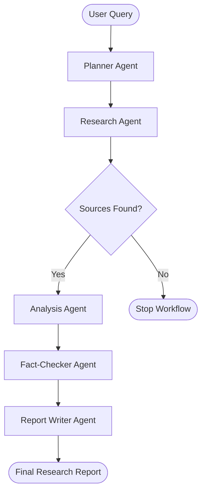

# Multi-Agent Research Assistant

An AI-powered research assistant built with **Python, LangGraph, and the OpenAI API**.

The application uses five specialised agents to plan research, collect information, analyse findings, verify claims, and generate structured research reports.

## Key Features

- **Multi-agent architecture** with five specialised agents.
- **LangGraph orchestration** for managing the research workflow.
- **Automated research** using Wikipedia and arXiv.
- **Web content extraction** for collecting source material.
- **LLM-powered analysis** of research findings.
- **Fact-checking** against collected evidence.
- **Structured report generation** with source references.
- **Streamlit web interface** and command-line execution.
- **Input validation and error handling.**
- **Automated tests** using pytest.

## Architecture

The workflow consists of five agents:

| Agent | Responsibility |
|---|---|
| Planner Agent | Creates a structured research plan |
| Research Agent | Searches for and collects relevant sources |
| Analysis Agent | Analyses findings and identifies patterns |
| Fact-Checker Agent | Verifies claims against available evidence |
| Report Writer Agent | Generates the final research report |

### Workflow



The agents share information through a common `AgentState`, while LangGraph manages workflow execution and conditional routing.

## Technology Stack

- Python
- LangGraph
- OpenAI API
- Streamlit
- Requests
- BeautifulSoup4
- DDGS
- arXiv API
- Pytest

## Project Structure

```text
multi-agent-research-assistant/
|
|-- app.py
|-- main.py
|-- requirements.txt
|-- .env.example
|-- .gitignore
|-- README.md
|
|-- src/
|   |-- __init__.py
|   |-- agents.py
|   |-- planner.py
|   |-- analysis_agent.py
|   |-- fact_checker.py
|   |-- report_writer.py
|   |-- llm_client.py
|   |-- config.py
|   |-- state.py
|   |-- nodes.py
|   |-- workflow.py
|   |
|   |-- tools/
|       |-- search.py
|       |-- arxiv.py
|       |-- fetch.py
|
|-- tests/
    |-- test_agents.py
    |-- test_analysis_agent.py
    |-- test_arxiv.py
    |-- test_config.py
    |-- test_fact_checker.py
    |-- test_fetch.py
    |-- test_llm_client.py
    |-- test_main.py
    |-- test_nodes.py
    |-- test_planner.py
    |-- test_report_writer.py
    |-- test_search.py
    |-- test_workflow.py
```

## Installation

### 1. Clone the repository

```bash
git clone https://github.com/nientevvv-sketch/multi-agent-research-assistant.git
cd multi-agent-research-assistant
```

### 2. Create a virtual environment

```bash
python -m venv .venv
```

Activate it on Windows:

```cmd
.venv\Scripts\activate
```

On macOS/Linux:

```bash
source .venv/bin/activate
```

### 3. Install dependencies

```bash
pip install -r requirements.txt
```

### 4. Configure environment variables

Create your `.env` file:

```cmd
copy .env.example .env
```

Add your OpenAI API key and model configuration:

```env
OPENAI_API_KEY=your_api_key_here
OPENAI_MODEL=your_available_model
```

Use a model available to your OpenAI API account.

**Important:** Never commit your `.env` file or expose your API key.

## Running the Application

### Streamlit Web Interface

Start the web application:

```bash
streamlit run app.py
```

Open the local URL displayed in the terminal, usually:

```text
http://localhost:8501
```

Enter a research question in the interface and start the research workflow.

### Command-Line Interface

Alternatively, run the application in the terminal:

```bash
python main.py
```

Enter a research question when prompted. The generated report is saved in the `reports/` directory.

**Note:** Both execution modes require a valid OpenAI API key and available API usage limits.

## Testing

Run the complete test suite:

```bash
python -m pytest -v
```

**Latest local test result: 74 passed.**

Tests cover:

Agent behaviour and validation

Research tools and source collection

OpenAI API error handling

Workflow execution and conditional routing

Report generation

Main application behaviour

Tests use mocks where appropriate and do not require live OpenAI API calls.

Current Limitations

Research quality depends on source availability and language model output.

Fact-checking helps identify unsupported claims but does not guarantee complete factual accuracy.

API rate limits and service availability may affect live research execution.

The workflow follows a predefined agent sequence rather than dynamically creating new agents.

Future Improvements

Source credibility scoring

More advanced research planning

Research quality evaluation

Improved workflow monitoring and tracing

Author

Developed as a personal AI engineering portfolio project.

GitHub: https://github.com/nientevvv-sketch
